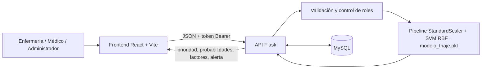

# Arquitectura implementada

## Flujo de extremo a extremo
1. El profesional registra al paciente en el frontend (datos de identificación, 6 signos vitales y 10 síntomas de alarma).
2. El frontend envía los datos a `POST /api/atenciones` con el token de sesión.
3. La API valida rangos y rol, y construye el vector de 16 variables en el orden de `model_card.json`.
4. El Pipeline (escalador + SVM) predice la prioridad y sus probabilidades.
5. La API calcula los factores de referencia y la alerta de valores críticos, guarda la atención y su primer evento en MySQL y responde al frontend.
6. El profesional confirma o modifica la prioridad (`PATCH /api/atenciones/{id}/revision`); el motivo es obligatorio si la cambia.
7. La cola (`GET /api/cola`) se ordena por prioridad vigente y hora de registro.

## Componentes
| Componente | Tecnología | Archivo |
|---|---|---|
| Interfaz | React 19, Vite, React Router | `frontend/` |
| API | Flask, Flask-SQLAlchemy, Flask-CORS | `backend/app.py` |
| Modelo | scikit-learn: StandardScaler + SVC (RBF) | `entrenar_triaje.py`, `modelo_triaje.pkl` |
| Ficha del modelo | JSON | `model_card.json` |
| Base de datos | MySQL (SQLite por defecto) | tablas `usuario`, `atencion`, `evento` |
| Datos de demostración | Python | `backend/seed_demo.py` |
